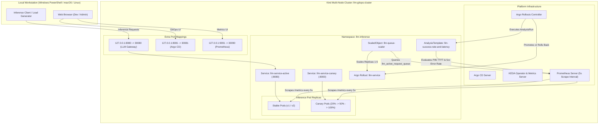

# Production-Grade GitOps LLM Inference Platform on Kubernetes

[](https://kind.sigs.k8s.io/)
[](https://argoproj.github.io/cd/)
[](https://argoproj.github.io/rollouts/)
[](https://keda.sh/)
[](https://prometheus.io/)
[](https://fastapi.tiangolo.com/)

A production-grade, lightweight GitOps and progressive delivery platform for LLM inference workloads. Built with **Kind**, **Docker**, **Kubectl**, **Argo CD**, **Argo Rollouts**, and **KEDA**, optimized to run smoothly on a local developer laptop without requiring GPU hardware or consuming gigabytes of memory.

---

## 🏛️ System Architecture



---

## 🚀 Key Architectural Highlights

1. **Local-First & Resource Efficient (< 1.5 GB RAM)**:
   - Runs a lightweight FastAPI LLM engine that replicates vLLM/Ollama streaming behavior (token chunk emission, Time-to-First-Token, queue tracking) without downloading heavy weights or requiring GPUs.
   - Includes standalone, optimized Prometheus scraping every 5 seconds.
2. **Zero-Registry Local Workflow**:
   - Docker images are built and loaded directly into Kind node storage using `kind load docker-image`.
3. **Metric-Driven Progressive Canary Delivery**:
   - Progressive traffic splitting (20% $\rightarrow$ Analysis $\rightarrow$ 50% $\rightarrow$ 100%).
   - Automated `AnalysisTemplate` evaluating:
     - **Error Rate**: HTTP 5xx $< 1\%$.
     - **Latency**: P95 Time-to-First-Token (TTFT) $< 500\text{ms}$.
   - Instant automated rollback upon threshold violation.
4. **Queue-Depth Event Autoscaling**:
   - KEDA monitors custom metric `llm_active_request_queue` from Prometheus.
   - Automatically scales inference replicas from 1 to 5 when concurrency $> 5$ requests.

---

## 📂 Repository Structure

```text
argo-deploy/
├── kind-config.yaml              # Kind 2-node cluster config with hostPort mappings
├── README.md                     # Documentation and architecture guide
├── app/
│   ├── main.py                   # FastAPI LLM server with metrics & chaos triggers
│   ├── requirements.txt          # Python dependencies (FastAPI, Uvicorn, Prometheus)
│   └── Dockerfile                # Multi-stage/minimal secure container image
├── infra/
│   ├── argocd/                   # Argo CD patch manifests (NodePort on 8081, insecure mode)
│   ├── argo-rollouts/            # Argo Rollouts infrastructure reference
│   ├── keda/                     # KEDA autoscaler infrastructure reference
│   └── prometheus/               # Lightweight Prometheus (RBAC, ConfigMap, Deployment)
├── gitops/
│   ├── argocd-app.yaml           # Declarative Argo CD Application
│   ├── rollout.yaml              # Argo Rollout with Canary strategy (20/50/100)
│   ├── services.yaml             # Active NodePort & Canary ClusterIP services
│   ├── analysis-template.yaml    # Prometheus-backed AnalysisTemplate for Canary verification
│   └── keda-scaledobject.yaml    # KEDA ScaledObject tracking llm_active_request_queue
└── scripts/
    ├── setup-cluster.ps1         # Full cluster and platform bootstrap (PowerShell)
    ├── setup-cluster.sh          # Full cluster and platform bootstrap (Bash)
    ├── test-traffic.ps1          # Concurrency test driving KEDA autoscaling (PowerShell)
    ├── test-traffic.sh           # Concurrency test driving KEDA autoscaling (Bash)
    ├── trigger-canary.ps1        # Canary rollout deployment & split verification (PowerShell)
    ├── trigger-canary.sh         # Canary rollout deployment & split verification (Bash)
    ├── trigger-rollback.ps1      # Degraded canary rollout & auto-rollback demo (PowerShell)
    └── trigger-rollback.sh       # Degraded canary rollout & auto-rollback demo (Bash)
```

---

## 🛠️ Prerequisites

Ensure the following tools are installed on your machine:
- **Docker Desktop** (running with Linux containers enabled)
- **Kind** (`v0.20+`): `winget install Kubernetes.kind` or `choco install kind`
- **Kubectl** (`v1.27+`): `winget install Kubernetes.kubectl`
- **PowerShell 7+** (or standard Windows PowerShell 5.1)

---

## 📖 Step-by-Step Walkthrough

### Step 1: Bootstrap the Kind Cluster and Infrastructure

Run the bootstrap script. It will create the cluster, build and load 3 application images (`v1`, `v2`, `v2-degraded`), install Argo CD, Argo Rollouts, Prometheus, and KEDA, and deploy the baseline GitOps workload.

**PowerShell:**
```powershell
.\scripts\setup-cluster.ps1
```

**Bash / WSL (Alternative):**
```bash
./scripts/setup-cluster.sh
```

Once complete, access the platform endpoints:
| Component | Local URL | Credentials / Notes |
| :--- | :--- | :--- |
| **LLM Inference Gateway** | `http://localhost:8080/v1/chat/completions` | POST endpoint with streaming SSE |
| **Prometheus Dashboard** | `http://localhost:9091` | Query metrics like `llm_active_request_queue` |
| **Argo CD UI** | `http://localhost:8081` | Username: `admin`, Password printed in script output |

---

### Step 2: Test LLM Inference & KEDA Queue Autoscaling

Run the traffic generator to simulate 15 concurrent inference requests. This spikes `llm_active_request_queue` above the threshold of 5, triggering KEDA to scale the Rollout replicas from 1 to multiple pods:

**PowerShell:**
```powershell
.\scripts\test-traffic.ps1
```

**Bash / WSL:**
```bash
./scripts/test-traffic.sh
```

**What you will observe:**
- The Prometheus metric `llm_active_request_queue` surges to 10–15.
- KEDA detects the metric breach and scales pods from 1 to 3+ replicas.
- After traffic stops, KEDA smoothly downscales pods back to baseline.

---

### Step 3: Trigger a Progressive Canary Rollout (`v2`)

Deploy version `v2` (a healthy upgrade with improved TTFT):

**PowerShell:**
```powershell
.\scripts\trigger-canary.ps1
```

**Bash / WSL:**
```bash
./scripts/trigger-canary.sh
```

**What you will observe:**
1. **Canary traffic split**: 20% of traffic routes to `v2` while 80% remains on `v1`. The script samples 20 live requests and displays the active distribution.
2. **Automated Analysis**: Argo Rollouts triggers an `AnalysisRun` querying Prometheus for error rate ($< 1\%$) and P95 TTFT ($< 500\text{ms}$).
3. **Progressive Promotion**: With all metrics passing, traffic advances to 50%, then automatically promotes to 100%.

---

### Step 4: Trigger Automated Rollback on SLO Violation (`v2-degraded`)

Simulate a bad deployment where the new version suffers from high TTFT (> 1200ms) or GPU errors (HTTP 500s):

**PowerShell:**
```powershell
.\scripts\trigger-rollback.ps1
```

**Bash / WSL:**
```bash
./scripts/trigger-rollback.sh
```

**What you will observe:**
1. The faulty container image `llm-inference:v2-degraded` is deployed to the canary step (20%).
2. Traffic to the canary replica triggers high TTFT latency and 500 errors.
3. Prometheus scrapes the degraded metrics.
4. The `AnalysisTemplate` evaluates the SLO rules and marks the `AnalysisRun` as **`Failed`**.
5. **Zero-downtime Rollback**: Argo Rollouts immediately aborts the deployment, terminates the canary pods, and resets 100% of traffic back to the healthy stable replica (`v1`).

---

### Step 5: Argo CD GitOps Application Management

To register this repository with Argo CD:

1. Push your repository to GitHub (or your preferred Git provider).
2. Edit [`gitops/argocd-app.yaml`](gitops/argocd-app.yaml) and update `repoURL` with your repository URL.
3. Apply the application:
   ```powershell
   kubectl apply -f gitops/argocd-app.yaml
   ```
4. Open the Argo CD UI at `http://localhost:8081` to view automated synchronization and self-healing.

---

### Teardown

To delete the cluster and free up all local resources:
```powershell
kind delete cluster --name llm-gitops-cluster
```

---

## 💼 Resume-Ready Impact Bullet Points

Highlight this project on your resume under **DevOps / MLOps / Platform Engineering**:

* **Progressive Delivery & Automated Rollbacks (SRE / GitOps):**  
  *Architected a zero-downtime progressive delivery pipeline on Kubernetes using Argo CD and Argo Rollouts; implemented canary deployments with automated Prometheus-backed `AnalysisTemplates` that continuously evaluate P95 Time-to-First-Token (<500ms) and HTTP error rates (<1%), automatically aborting faulty releases with zero human intervention.*

* **Event-Driven Autoscaling for AI/ML Workloads (MLOps):**  
  *Engineered an event-driven autoscaling architecture using KEDA and custom Prometheus metrics (`llm_active_request_queue`), eliminating CPU-based autoscaling lag by dynamically provisioning inference replicas based on real-time request queue depth under high concurrency.*

* **Cloud-Native GitOps Platform Engineering (DevOps):**  
  *Built an end-to-end, multi-node Kubernetes platform using Kind and Docker for local emulation of production LLM serving stacks; authored declarative infrastructure manifests and automated PowerShell/Bash orchestration tooling reducing developer onboarding and testing cycle time.*
